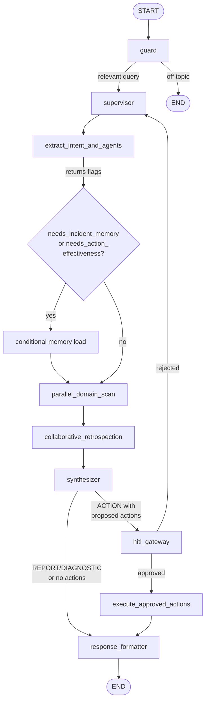

# Kimi - AI E-Commerce Operations Brain

Kimi is a multi-agent e-commerce operations assistant. The frontend provides a chat-style operator UI with live trace updates, approval cards, markdown reports, tables, and charts. The backend runs a LangGraph orchestration pipeline that selects domain agents, gathers operational data through MCP tools, performs cross-domain synthesis, optionally pauses for human approval, executes approved write actions, and formats the final response. The MCP server is the tool layer that reads and writes the operational database.

## Folder Structure

```text
Kimi/
+-- backend/
|   +-- app/
|   |   +-- agents/
|   |   |   +-- config/
|   |   |   |   +-- definitions.py        # Agent identities, goals, tool allow-lists
|   |   |   |   +-- prompt_builder.py     # Builds domain-agent system prompts
|   |   |   +-- orchestrator/
|   |   |   |   +-- graph.py              # LangGraph assembly
|   |   |   |   +-- llm.py                # Chat model factory
|   |   |   |   +-- nodes/                # Orchestrator node implementations
|   |   |   +-- subgraphs/                # Sales, inventory, marketing, support agents
|   |   |   +-- base.py                   # Shared BaseAgent and MCP tool loading
|   |   |   +-- state.py                  # OrchestratorState and SubAgentState
|   |   +-- db/
|   |   |   +-- models/                   # SQLModel table definitions
|   |   |   +-- session.py                # Async SQLAlchemy engine/session setup
|   |   +-- routes/
|   |   |   +-- v1/                       # FastAPI route modules
|   |   +-- schemas/                      # Request/response Pydantic schemas
|   |   +-- services/                     # Memory, history, seeding, observability
|   |   +-- config.py                     # Pydantic settings and environment config
|   +-- tests/
|   |   +-- conftest.py                    # Pytest bootstrap for app package imports
|   |   +-- test_agents.py                # Supervisor source-contract tests
|   |   +-- test_intent_extraction.py     # Intent extraction schema tests
|   |   +-- test_routes.py                # Route-layer helper tests
|   +-- main.py                           # FastAPI entrypoint
|   +-- pyproject.toml                    # Backend dependencies managed by uv
|   +-- Dockerfile
+-- frontend/
|   +-- src/
|   |   +-- api/
|   |   |   +-- client.js                 # API client for conversations and runs
|   |   +-- components/
|   |   |   +-- ActionCards.jsx           # Human approval/rejection UI
|   |   |   +-- ChatArea.jsx              # Chat message layout
|   |   |   +-- InputBar.jsx              # User query input
|   |   |   +-- Message.jsx               # Message rendering and report-data parsing
|   |   |   +-- ReportView.jsx            # Tables and charts rendered with Recharts
|   |   |   +-- Sidebar.jsx               # Conversation history sidebar
|   |   |   +-- TracePanel.jsx            # Live graph execution trace
|   |   +-- App.jsx                       # Main UI state and streaming orchestration
|   |   +-- index.css                     # Tailwind and app styles
|   |   +-- main.jsx                      # React entrypoint
|   +-- package.json
|   +-- vite.config.js
|   +-- tailwind.config.js
|   +-- Dockerfile
+-- mcp_server/
|   +-- tools/
|   |   +-- inventory.py                  # Inventory read tools and approved write tools
|   |   +-- marketing.py                  # Marketing campaign tools
|   |   +-- sales.py                      # Sales and order analytics tools
|   |   +-- support.py                    # Support, ticket, and Qdrant tools
|   +-- server.py                         # FastMCP app and tool registration
|   +-- start_server.py                   # SSE launcher for Windows-friendly startup
|   +-- run.ps1                           # PowerShell helper
|   +-- pyproject.toml
+-- docker-compose.yml                    # Postgres and Qdrant services
```

## What Each Part Does

### Frontend

The frontend is a Vite + React application. It renders the operator chat experience, keeps track of the current conversation, streams graph progress from the backend, and displays approval cards when the backend pauses for human review.

Important pieces:

- `frontend/src/App.jsx` manages conversations, live streaming events, final responses, and resume/approval flows.
- `frontend/src/api/client.js` calls `/api/conversations`, `/api/conversations/{thread_id}/messages`, `/api/run/stream`, `/api/run`, and `/api/resume`.
- `frontend/src/components/Message.jsx` renders markdown responses and extracts structured report JSON from `<!--REPORT_DATA-->...<!--/REPORT_DATA-->`.
- `frontend/src/components/ReportView.jsx` renders tables plus bar, line, and pie charts using Recharts.
- `frontend/src/components/ActionCards.jsx` shows human-in-the-loop approval and rejection controls for proposed actions.
- `frontend/src/components/TracePanel.jsx` shows live graph progress from server-sent events.

Charts are rendered in the frontend with `recharts`. The backend does not render images or chart components. Instead, the backend response formatter appends a structured JSON block to the final markdown response, and the frontend parses that block into chart props.

### Backend

The backend is a FastAPI service that owns the agent orchestration. It initializes database tables, configures LangSmith tracing, creates a LangGraph checkpointer in Postgres, compiles the supervisor graph, and exposes API routes for running and resuming analysis.

Important pieces:

- `backend/main.py` starts FastAPI, creates tables, configures tracing, sets up the LangGraph Postgres checkpointer, and registers routers.
- `backend/app/routes/v1/analysis.py` exposes `/api/run/stream`, `/api/run`, and `/api/resume`.
- `backend/app/routes/v1/conversations.py` exposes sidebar and message history endpoints.
- `backend/app/agents/orchestrator/graph.py` wires the LangGraph nodes.
- `backend/app/agents/orchestrator/nodes/` contains the graph node logic.
- `backend/app/agents/subgraphs/` contains the domain sub-agents.
- `backend/app/agents/base.py` loads MCP tools and runs domain agents with shared behavior.
- `backend/app/services/agent_memory.py` persists and retrieves run memories, including Qdrant vector retrieval.
- `backend/app/services/conversation_history.py` persists chat threads and messages.
- `backend/app/services/seeder.py` and `backend/app/services/seeder_historical.py` populate sample operational data.

### MCP Server

The MCP server is a FastMCP tool server. Domain agents do not directly query or mutate business tables; they call MCP tools. Most tools are read-only analytics tools. Write tools exist, but they should only run from the `execute_approved_actions` graph node after human approval.

All tools are dynamically loaded into domain agents via LangChain MCP adapters at runtime, not hardcoded into agent code. This keeps agent logic independent from specific tool implementations.

Important pieces:

- `mcp_server/server.py` creates the shared `FastMCP` app and registers tools from all domain modules.
- `mcp_server/start_server.py` starts the MCP server over SSE, useful on Windows.
- `mcp_server/tools/inventory.py` contains product lookup, stock checks, supplier order reads, and inventory write actions.
- `mcp_server/tools/sales.py` contains revenue, order-volume, regional, payment, and device analytics.
- `mcp_server/tools/marketing.py` contains campaign performance, promotion checks, spend distribution, campaign write actions (pause, budget adjust, status update), and campaign creation with auto-generated IDs and product resolution.
- `mcp_server/tools/support.py` contains ticket metrics, ticket search, Qdrant incident retrieval, return reasons, fulfillment delays, and escalation write actions.

## Graph Diagram




## Graph Nodes

- `guard`: Classifies whether the user query belongs to e-commerce operations. Off-topic queries short-circuit with a rejection message.
- `supervisor`: Classifies intent as `REPORT`, `DIAGNOSTIC`, or `ACTION`, selects relevant domain agents, and creates per-agent goals. Intent extraction returns two semantic flags: `needs_incident_memory` (request historical precedent) and `needs_action_effectiveness` (request past action performance data). Supervisor conditionally loads these without hardcoded query phrase matching. On rejection loops, it refines goals and reruns affected domains.
- `parallel_domain_scan`: Runs selected domain agents in parallel and writes findings plus draft actions to the shared whiteboard.
- `collaborative_retrospection`: Lets selected agents inspect peer findings, revise conclusions, and check cross-domain relationships.
- `synthesizer`: Combines domain findings into a cross-domain report. It ranks and enriches proposed actions but does not invent new actions.
- `hitl_gateway`: Human-in-the-loop checkpoint. It routes approved actions to execution or rejected actions back to the supervisor.
- `execute_approved_actions`: Calls approved MCP write tools, sanitizes parameters against tool schemas, and records execution results.
- `response_formatter`: Converts the internal report into an operator-facing markdown response. For report queries, it also emits structured table/chart JSON for the frontend.

## Testing

The backend test suite uses lightweight source-contract tests that guard against regressions without requiring full runtime dependencies:

- `test_agents.py`: Supervisor uses intent-derived flags (not hardcoded cues) for memory/effectiveness decisions.
- `test_intent_extraction.py`: Intent extractor includes and parses `needs_incident_memory` and `needs_action_effectiveness` schema fields.
- `test_routes.py`: Analysis route uses intent flags for leaderboard inclusion (no hardcoded query cues).

Run tests: `pytest -q` from the backend directory.

## Sub-Agents

### SalesAgent

Tracks revenue trends, order volume, payment gateway health, regional sales, top revenue contributors, and device breakdowns. It is read-only and does not propose write actions.

Tools:

- `get_sales_metrics_trend`
- `get_hourly_order_volume`
- `get_top_revenue_contributors`
- `get_regional_sales_breakdown`
- `get_payment_gateway_performance`
- `get_order_device_breakdown`

### InventoryAgent

Monitors stock levels, product identifiers, restock status, inventory ledgers, supplier orders, logistics, and brand-level inventory. It can propose inventory write actions for HITL approval.

Tools:

- `resolve_product_identifiers`
- `check_stock_status`
- `get_inventory_ledgers`
- `get_incoming_supplier_orders`
- `get_logistics_and_dimensions`
- `get_brand_inventory_report`
- `update_safety_stock_trigger` approval-gated write
- `restock_product_emergency` approval-gated write

### MarketingAgent

Analyzes campaign ROI, spend efficiency, active promotions, hourly spend distribution, and product/campaign relationships. It can propose campaign budget, pause, status changes, or new campaign creation for HITL approval.

Tools:

- `resolve_campaign_identifiers`
- `get_campaign_performance`
- `check_active_promotions`
- `get_hourly_spend_distribution`
- `pause_marketing_campaign` approval-gated write
- `adjust_campaign_budget` approval-gated write
- `update_campaign_status` approval-gated write — generic status mutation (ACTIVE/PAUSED/COMPLETED/BUDGET_EXHAUSTED)
- `create_marketing_campaign` approval-gated write — auto-resolves product name to product_id, generates campaign_id in CAMP-<PREFIX>-<NNN> format, and initializes campaign with user-specified budget

### SupportAgent

Detects customer distress, ticket spikes, sentiment problems, product return reasons, fulfillment delays, and historical incidents from Qdrant. It can propose priority engineering tickets for HITL approval.

Tools:

- `get_support_ticket_metrics`
- `query_historical_incidents_qdrant`
- `search_ticket_sentiments`
- `get_product_return_reasons`
- `get_fulfillment_delay_analysis`
- `create_priority_dev_ticket` approval-gated write

## Database Tables

The backend uses SQLModel over PostgreSQL. Tables are created from `backend/app/db/models/`.

### `products_inventory`

Master product catalog and live inventory ledger. It stores product metadata, SKU, brand/category, pricing, stock counters, safety stock level, reorder quantity, restock status, supplier information, dimensions, warehouse location, and activity timestamps.

### `order_items`

Sales/order line-item table. It stores order id, customer id, product id, quantity, unit price, discounts, gross revenue, payment gateway/status, shipping location/cost, fulfillment state, checkout device, delivery dates, promo code, and creation timestamp.

### `marketing_campaigns`

Ad campaign performance table. It stores campaign id/name, channel, target product, audience, daily budget, spend, impressions, clicks, CTR, CPC, attributed revenue, campaign status, UTM code, hourly spend log, and timestamps.

### `customer_support_tickets`

Support ticket table. It stores ticket id, customer id, order id, product id, subject, full customer text, category, priority, status, sentiment score, assigned agent, resolution type, and lifecycle timestamps.

### `conversation_threads`

Chat sidebar table. It stores each conversation thread id, title, last run id, last status, creation time, and update time.

### `conversation_messages`

Message history table. It stores every user/assistant/system message with thread id, run id, role, message type, content, and timestamp.

### `agent_run_memories`

Long-term run memory table. It stores run id, thread id, query text, status, summary text, detailed text, whiteboard JSON, proposed actions JSON, execution result JSON, and vectorization timestamps.

## Tech Stack

### Frontend

- React 19
- Vite 6
- Tailwind CSS
- Recharts
- React Markdown
- Remark GFM
- Lucide React

### Backend

- Python 3.11+
- FastAPI
- Uvicorn
- Pydantic and Pydantic Settings
- LangChain
- LangGraph
- LangGraph Postgres Checkpointing
- LangSmith tracing
- SQLModel
- SQLAlchemy asyncio
- asyncpg / psycopg
- Qdrant client
- FastMCP / LangChain MCP adapters
- uv for Python dependency management

### MCP Server

- FastMCP
- SQLModel
- SQLAlchemy asyncio
- asyncpg
- Qdrant client
- Pydantic Settings

### Infrastructure

- PostgreSQL 16
- Qdrant
- Docker Compose

## API Surface

- `GET /health`: liveness check.
- `GET /api/conversations?limit=50`: list conversation threads for the sidebar.
- `GET /api/conversations/{thread_id}/messages?limit=200`: fetch one conversation's messages.
- `POST /api/run/stream`: run an analysis with server-sent trace events.
- `POST /api/run`: run an analysis without SSE streaming.
- `POST /api/resume`: resume a paused HITL graph with approved/rejected actions.

## Report Charts Flow

1. The user asks a report-style question from the frontend.
2. The backend graph classifies the query as `REPORT`.
3. Domain agents gather numbers through MCP read tools.
4. The synthesizer creates the internal cross-domain report.
5. `response_formatter` creates a clean markdown answer and appends:

```text
<!--REPORT_DATA-->
{
  "tables": [],
  "charts": []
}
<!--/REPORT_DATA-->
```

6. `Message.jsx` strips that block from the markdown and parses it as JSON.
7. `ReportView.jsx` renders tables, bar charts, line charts, and pie charts with Recharts.

## Runtime Services

`docker-compose.yml` starts:

- `db`: PostgreSQL exposed on host port `5454`.
- `qdrant`: Qdrant exposed on ports `6333` and `6334`.

The backend expects Postgres and Qdrant settings from environment variables or `backend/.env`. The MCP server imports the backend `app.*` package so it can reuse models, sessions, and settings while remaining a separate tool server.

## Seeding A Fresh Environment

A new user will start with empty Postgres and Qdrant volumes. Start the stack first:

```powershell
docker compose up -d --build
```

Then seed Postgres with the base operational dataset:

```powershell
docker compose exec backend python -m app.services.seeder
```

Then add the historical dataset:

```powershell
docker compose exec backend python -m app.services.seeder_historical
```

Then populate Qdrant with support-ticket embeddings:

```powershell
docker compose exec backend python -m app.services.embed_tickets
```

The order matters:

1. `seeder` creates base products, campaigns, orders, and support tickets.
2. `seeder_historical` adds 2025 to 2026 historical orders, campaigns, and tickets.
3. `embed_tickets` reads support tickets from Postgres and writes vectors into Qdrant.

`embed_tickets` requires a valid `DIAL_API_KEY` because it calls the embedding model. If that key is missing, Postgres seeding can still work, but Qdrant ingestion will fail.

For a full clean reset and seeding historical data:

```powershell
docker compose down -v
docker compose up -d --build
docker compose exec backend python -m app.services.seeder
docker compose exec backend python -m app.services.seeder_historical
docker compose exec backend python -m app.services.embed_tickets
docker compose exec backend python -m app.services.incident_seeder
```
